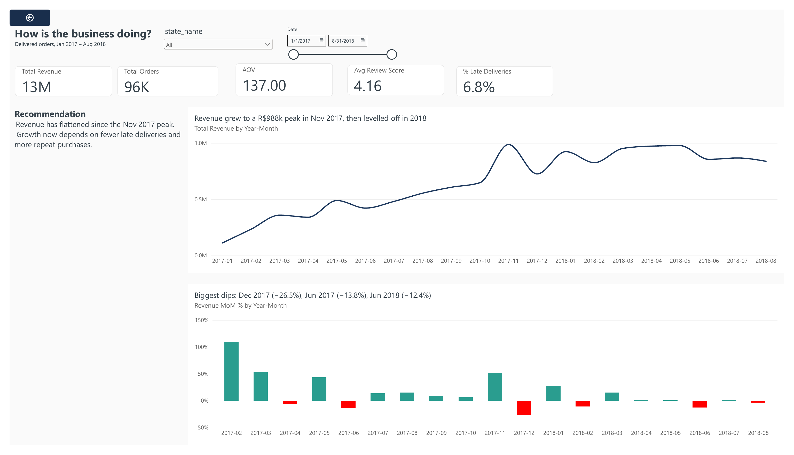
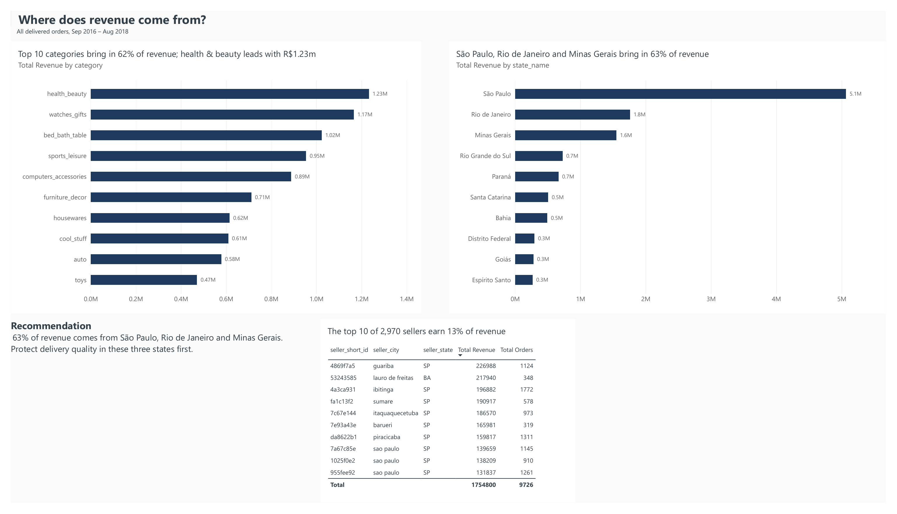
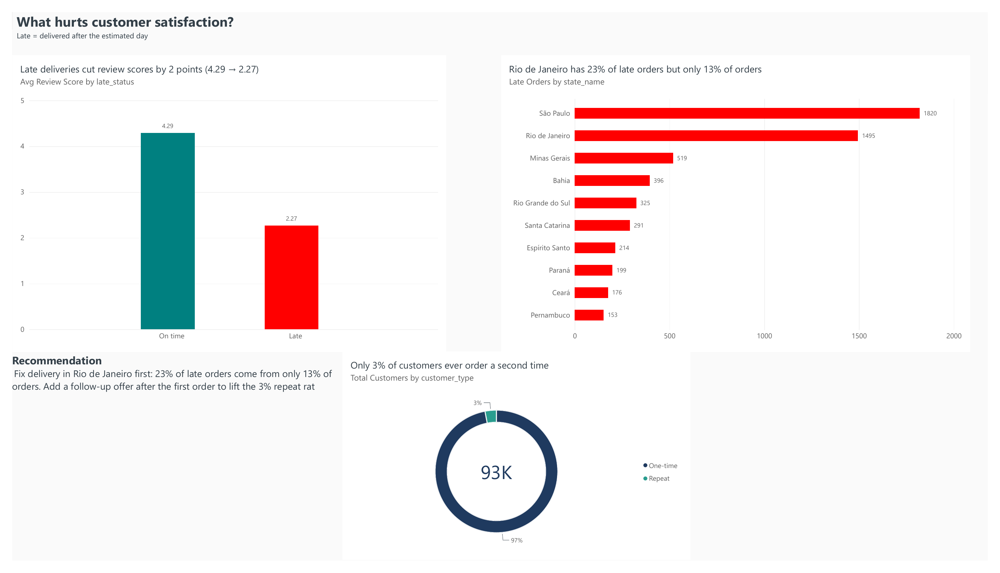

# E-commerce Sales Performance Analysis

**SQL (MySQL) and Power BI analysis of 96,000 delivered orders from a Brazilian online marketplace: where revenue comes from, what hurts customer satisfaction, and what to do about it.**



*Overview page of the 3-page Power BI dashboard. All pages are below, or open the [full dashboard PDF](powerbi/ecommerce_dashboard.pdf).*

## Business problem

An online marketplace wants to know how sales are trending, which products and regions drive revenue, whether delivery problems are damaging customer satisfaction, and whether customers come back. I used SQL to answer four business questions and turned the results into findings, recommendations and a dashboard plan for a non-technical manager.

## Key findings

- **Late deliveries cost about 2 review points.** 6.8% of orders arrive late, and those orders average **2.27 stars against 4.29** for on-time orders. 54% of late orders get a 1-star review.
- **Only 3.0% of customers buy again** (2,801 of 93,358), bringing in 5.5% of revenue. A repeat customer is worth R$260, against R$138 for a one-time buyer.
- **Rio de Janeiro has a delivery problem.** It has **23% of all late orders but only 13% of orders**: its late rate is 12.1%, against 4.5% in São Paulo.
- **Revenue is concentrated, and growth has stalled.** Three states (São Paulo, Rio de Janeiro, Minas Gerais) bring in **63%** of the R$13.2m revenue. Monthly revenue peaked at R$988k in Nov 2017 and levelled off at R$826k–R$978k through 2018.

## Recommendations

1. **Fix delivery in Rio de Janeiro and in busy periods.** Rio has 12.1% of orders late and 23% of all late orders. Late rates hit 12.4% in Nov 2017 and 19.0% in Mar 2018. Review carriers, set realistic estimates, and tell customers before an order is late.
2. **Launch a second-order programme** for customers whose first order arrived on time. Each extra 1% of customers making one more order is worth about R$128k.
3. **Recruit sellers outside the South-East.** One seller holds 78% of Bahia's seller revenue, and the Northeast has the highest late rate (12.7%).

Full detail: [docs/findings.md](docs/findings.md)

## Dashboard

Three pages, each answering one business question. Every chart title states the finding, and each page ends with a recommendation.

**1. How is the business doing?** KPI cards, monthly revenue trend and month-on-month change (dips in red).


**2. Where does revenue come from?** Top categories, revenue by state and top sellers.



**3. What hurts customer satisfaction?** Reviews for late vs on-time orders, late orders by state and repeat customers.



Files: [dashboard PDF](powerbi/ecommerce_dashboard.pdf) · [DAX measures](powerbi/dax_measures.md) · [build guide](powerbi/dashboard_build_guide.md)

## Tools

- **MySQL** (command-line client): schema design, data loading, data-quality checks, analysis with CTEs and window functions (`LAG`, `RANK`, `ROW_NUMBER`, `SUM OVER`)
- **Power BI**: star-schema data model, DAX measures (incl. month-on-month time intelligence), conditional formatting, 3-page dashboard
- **Git / GitHub**: one commit per project phase
- **Python**: one small helper that saves query results as CSV

## Data

- **Source:** [Brazilian E-Commerce Public Dataset by Olist](https://www.kaggle.com/datasets/olistbr/brazilian-ecommerce) on Kaggle. Thanks to Olist for publishing real, anonymised marketplace data.
- **Size:** 9 related tables, about 99k orders, 113k order items, 99k reviews and 3k sellers, Sep 2016 – Oct 2018.
- **Licence:** [CC BY-NC-SA 4.0](https://creativecommons.org/licenses/by-nc-sa/4.0/). The raw data isn't stored in this repo.
- **To reproduce:** download the dataset from Kaggle, unzip the 9 CSV files into `data/raw/`, then run the SQL files in order:

```bash
mysql < sql/00_create_schema.sql
mysql --local-infile=1 < sql/01_load_data.sql      # run from the project root
mysql -t olist < sql/02_data_quality_checks.sql
python3 scripts/export_results.py sql/03_monthly_revenue.sql   # same for 04–08
mysql olist < sql/09_powerbi_views.sql > /dev/null
python3 scripts/export_results.py sql/09_powerbi_views.sql data/exports/powerbi
```

## Process

| Step | What I did | Files |
|---|---|---|
| 1. Load | Designed 9 tables with keys and indexes. Loaded the CSVs and checked row counts against each file. Fixed a backslash in a review that merged two rows. | [00_create_schema.sql](sql/00_create_schema.sql), [01_load_data.sql](sql/01_load_data.sql) |
| 2. Quality checks | Ran 13 checks (statuses, nulls, duplicates, orphan rows, duplicate reviews, missing translations, sparse months) and logged every decision. | [02_data_quality_checks.sql](sql/02_data_quality_checks.sql), [cleaning_log.md](docs/cleaning_log.md) |
| 3. Analysis | Answered the four questions with one query file each. Every total reconciles to R$13,221,498.11 and 96,478 orders. | [03](sql/03_monthly_revenue.sql) · [04](sql/04_top_categories.sql) · [05](sql/05_revenue_by_state.sql) · [06](sql/06_late_delivery_impact.sql) · [07](sql/07_repeat_customers.sql) · [08](sql/08_top_sellers_by_state.sql) · [results](data/exports/) |
| 4. Dashboard | Built star-schema views, exported them for Power BI, and wrote the DAX measures, theme and a page-by-page build guide. | [09_powerbi_views.sql](sql/09_powerbi_views.sql), [powerbi/](powerbi/) |

**Business definitions:** revenue = item price of **delivered** orders (freight excluded). Late = delivered on a later calendar day than estimated. Customer = `customer_unique_id`, because `customer_id` changes with every order. Each order uses its **latest** review. See the [data dictionary](docs/data_dictionary.md).

## Example SQL: month-on-month growth with `LAG()`

From [03_monthly_revenue.sql](sql/03_monthly_revenue.sql):

```sql
WITH monthly AS (
    SELECT
        DATE_FORMAT(o.order_purchase_timestamp, '%Y-%m') AS order_month,
        SUM(oi.price)                                    AS revenue,
        COUNT(DISTINCT o.order_id)                       AS orders
    FROM orders AS o
    JOIN order_items AS oi
        ON oi.order_id = o.order_id
    WHERE o.order_status = 'delivered'
      AND o.order_purchase_timestamp >= '2017-01-01'
      AND o.order_purchase_timestamp <  '2018-09-01'
    GROUP BY order_month
)
SELECT
    order_month,
    ROUND(revenue, 2)          AS revenue,
    orders,
    ROUND(revenue / orders, 2) AS aov,
    -- LAG() looks back one row: the previous month's revenue
    ROUND(
        100 * (revenue - LAG(revenue) OVER (ORDER BY order_month))
            / LAG(revenue) OVER (ORDER BY order_month),
        2
    )                          AS revenue_mom_pct
FROM monthly
ORDER BY order_month;
```

## Limitations and next steps

**Limitations:**
- The data is Brazilian and from 2016–2018.
- There are no product costs, so I can't analyse profit.
- The review results show an association, not proven cause.
- "Late" is measured against Olist's own delivery estimate.

More in [findings.md](docs/findings.md#limitations).

**Next steps:**
- Test whether the distance between seller and customer explains late deliveries, using the geolocation table.
- Build a customer cohort view (repeat rate by first-order month).
- Analyse review text for the most common complaints.

## Contact

**Hein Htet Phyo**, BSc Data Science & AI (First Class), UWE Bristol

[heinhtetphyo.com](https://heinhtetphyo.com) · [LinkedIn](https://linkedin.com/in/hein-htet-phyo) · [GitHub](https://github.com/HeinHtet-Phyo)
